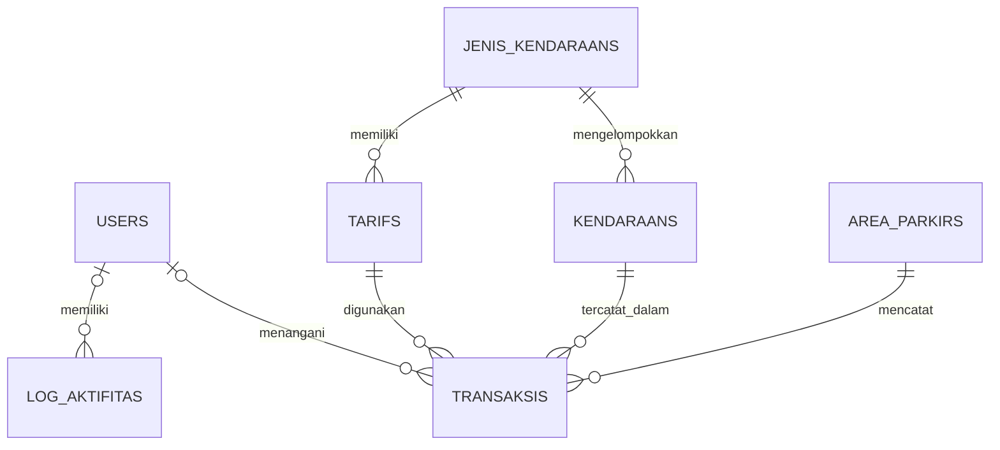

# ParkirYai

Aplikasi manajemen parkir sederhana berbasis Laravel untuk membantu pengelolaan kendaraan, area parkir, tarif, transaksi, dan riwayat parkir dengan pembayaran manual.

## Latar Belakang

Project ini dibuat sebagai bagian dari Uji Kompetensi Keahlian (UKK).

## Fitur

- Pengelolaan pengguna berdasarkan peran Owner, Admin, dan Petugas
- Pengelolaan jenis kendaraan dan data kendaraan
- Pengelolaan area parkir dan tarif parkir
- Pencatatan kendaraan masuk dan keluar
- Perhitungan biaya parkir berdasarkan durasi dan tarif
- Pencatatan transaksi parkir dengan pembayaran manual
- Pengelolaan riwayat transaksi dan pencetakan rekap
- Pencatatan aktivitas pengguna

## Teknologi

- Laravel
- Blade
- Alpine.js (digunakan pada sebagian antarmuka)
- Tailwind CSS
- MySQL

## Relasi Antar Model

Aplikasi ini menggunakan Eloquent ORM untuk mengelola relasi antar model. Relasi tersebut menghubungkan data pengguna, kendaraan, jenis kendaraan, tarif, area parkir, transaksi, dan log aktivitas.

### Diagram Relasi



### Penjelasan Relasi

| Model          | Relasi      | Model Tujuan   | Keterangan                                                                                 |
| -------------- | ----------- | -------------- | ------------------------------------------------------------------------------------------ |
| AreaParkir     | `hasMany`   | Transaksi      | Satu area parkir dapat memiliki banyak transaksi.                                          |
| JenisKendaraan | `hasMany`   | Kendaraan      | Satu jenis kendaraan dapat memiliki banyak data kendaraan.                                 |
| JenisKendaraan | `hasOne`    | Tarif          | Model mendefinisikan relasi satu tarif untuk satu jenis kendaraan.                         |
| Kendaraan      | `belongsTo` | JenisKendaraan | Setiap kendaraan terhubung dengan satu jenis kendaraan.                                    |
| Kendaraan      | `hasMany`   | Transaksi      | Satu kendaraan dapat tercatat dalam banyak transaksi parkir.                               |
| Tarif          | `belongsTo` | JenisKendaraan | Setiap tarif terhubung dengan satu jenis kendaraan.                                        |
| Tarif          | `hasMany`   | Transaksi      | Satu tarif dapat digunakan oleh banyak transaksi.                                          |
| Transaksi      | `belongsTo` | Kendaraan      | Setiap transaksi terhubung dengan kendaraan yang dicatat.                                  |
| Transaksi      | `belongsTo` | Tarif          | Setiap transaksi terhubung dengan tarif yang digunakan.                                    |
| Transaksi      | `belongsTo` | AreaParkir     | Setiap transaksi terhubung dengan area parkir yang digunakan.                              |
| Transaksi      | `belongsTo` | User           | Transaksi dapat dikaitkan dengan pengguna yang menanganinya. Relasi ini bersifat opsional. |
| User           | `hasMany`   | Transaksi      | Satu pengguna dapat menangani banyak transaksi.                                            |
| User           | `hasMany`   | LogAktifitas   | Satu pengguna dapat memiliki banyak catatan aktivitas.                                     |
| LogAktifitas   | `belongsTo` | User           | Catatan aktivitas dapat dikaitkan dengan pengguna. Relasi ini bersifat opsional.           |

### Catatan Relasi

- Kolom `user_id` pada tabel `transaksis` dan `log_aktifitas` bersifat opsional karena menggunakan `nullable()`.
- Database belum membatasi `jenis_kendaraan_id` pada tabel `tarifs` agar unik. Oleh karena itu, database masih memungkinkan beberapa tarif untuk satu jenis kendaraan, meskipun model `JenisKendaraan` menggunakan relasi `hasOne()`.
- Relasi dan aturan penghapusan data mengikuti foreign key yang didefinisikan pada migration.

## Cara Instalasi

### Persyaratan

Pastikan perangkat sudah memiliki perangkat lunak berikut:

- PHP
- Composer
- MySQL
- Node.js dan npm

### Langkah-Langkah Instalasi

1. Clone repository dari GitHub.

    ```bash
    git clone <URL-REPOSITORY>
    ```

2. Masuk ke direktori project.

    ```bash
    cd ParkirYai
    ```

3. Instal dependency PHP.

    ```bash
    composer install
    ```

4. Salin file konfigurasi lingkungan.

    ```bash
    cp .env.example .env
    ```

    Jika menggunakan Windows Command Prompt, jalankan:

    ```bat
    copy .env.example .env
    ```

5. Buat application key Laravel.

    ```bash
    php artisan key:generate
    ```

6. Konfigurasikan database melalui file `.env`.

    ```env
    DB_CONNECTION=mysql
    DB_HOST=127.0.0.1
    DB_PORT=3306
    DB_DATABASE=parkiryai
    DB_USERNAME=root
    DB_PASSWORD=
    ```

    Buat database bernama `parkiryai` melalui MySQL terlebih dahulu. Sesuaikan nama database, username, dan password dengan konfigurasi lingkungan masing-masing.

7. Jalankan migration dan seeder untuk membuat tabel database sekaligus mengisi data awal.

    ```bash
    php artisan migrate --seed
    ```

8. Instal dependency frontend, termasuk Alpine.js.

    ```bash
    npm install
    ```

9. Bangun aset frontend untuk digunakan oleh aplikasi.

    ```bash
    npm run build
    ```

10. Jalankan server pengembangan Laravel.

    ```bash
    php artisan serve
    ```

11. Buka aplikasi melalui browser dengan alamat berikut:

    `http://127.0.0.1:8000`

## Informasi Pengujian

Project ini dikembangkan sebagai bagian dari Uji Kompetensi Keahlian (UKK) dan telah diuji saat pelaksanaan UKK pada 18 April 2026.

- Lingkungan pengujian: lingkungan UKK
- Status: pernah diuji saat pelaksanaan UKK
